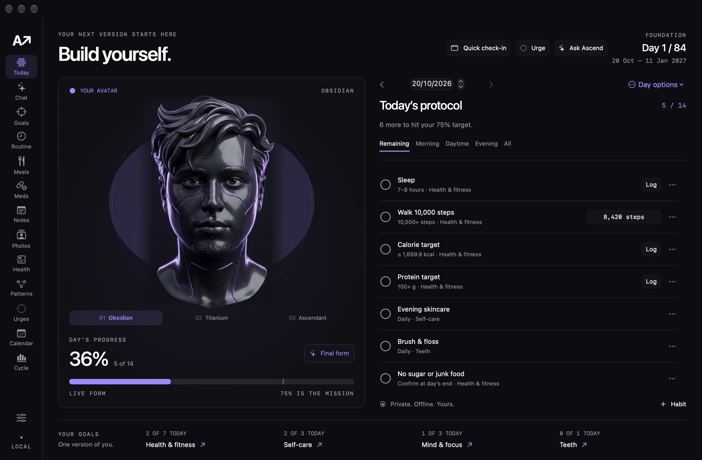
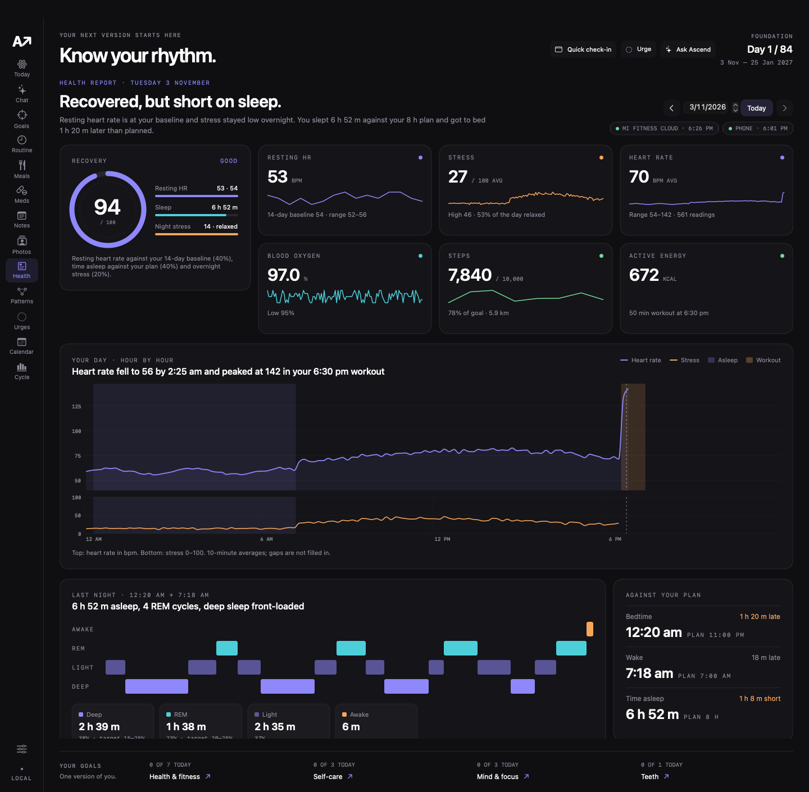
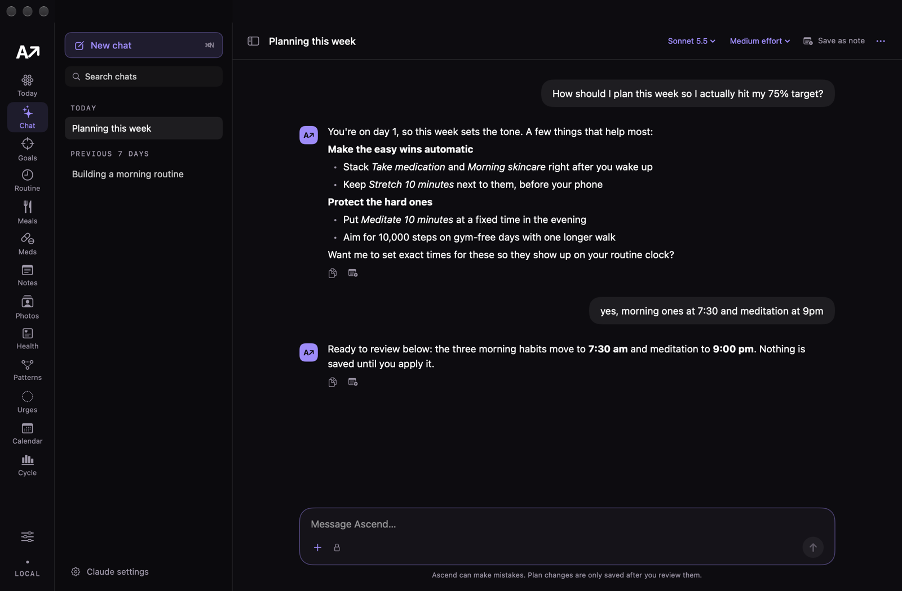
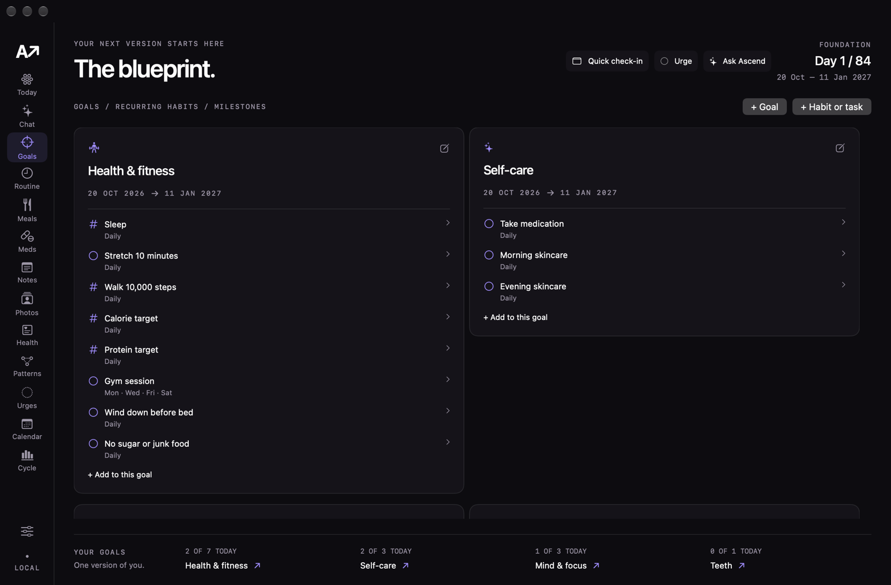
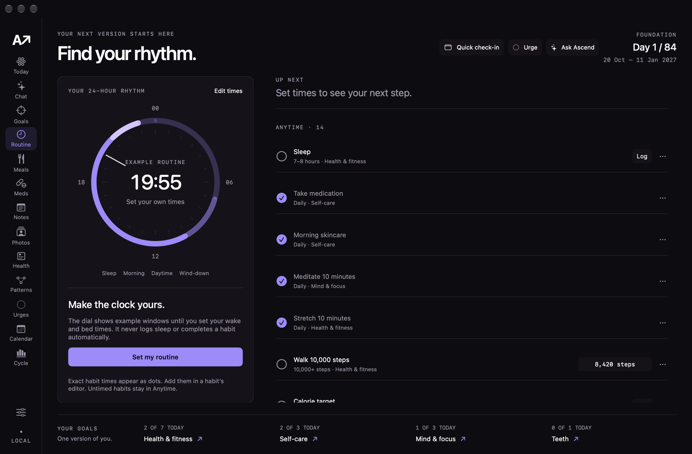

# Ascend

A private, local-first growth tracker for macOS, with an Android companion app.
Plan a 12-week cycle of goals and daily habits, check in from the Mac or your
phone, and let your watch, meal photos and medicine schedule fill in the numbers.
An avatar evolves (Obsidian → Titanium → Ascendant) as you earn the cycle.

- **Mac app** (SwiftUI): Today checklist, goals, routine clock, calendar, patterns,
  urges, meals, medicines, notes, progress photos, health charts and a menu bar panel.
- **Ask Ascend**: a full-screen chat that runs on your own [Claude Code](https://claude.com/claude-code)
  install. It talks through your plan and proposes edits you review before anything is saved.
- **Ascend Bridge** (Android): today's habits and avatar, meal and medicine photos,
  dose reminders and urge logging. It also brings Health Connect data (for example
  from a Mi Fitness watch) to the Mac over your Wi-Fi, end-to-end encrypted after a
  one-time 6-digit pairing.

Everything stays on your devices: no Ascend account, server or telemetry.
The only network calls are the phone-to-Mac link on your local network, the
Claude Code CLI when you use the AI features, and, only if you sign in, reading
your own watch data from the Mi Fitness cloud.

## Screenshots





| Ask Ascend chat | Goals |
|---|---|
|  |  |



Shown with the neutral starter plan, sample chats and generated sample watch data.

## Run

Requires macOS 14 or later and Apple Command Line Tools / Swift 6. The AI features
(chat, meal estimates, medicine sorting, note summaries) need Claude Code installed
and signed in; everything else works without it.

```sh
chmod +x scripts/build-app.sh
./scripts/build-app.sh
open build/Ascend.app
```

The app bundle is locally ad-hoc signed. No Apple account or server is needed.
For development, use `swift run --disable-sandbox Ascend`.

## Features

Full usage instructions: [User guide](docs/USER-GUIDE.md).

- Today: dated check-ins, numbers, morning/day/evening views and backfilling.
- Routine: a native 24-hour clock, configurable wake/bed/morning/wind-down windows,
  exact habit times and a next-event preview. Time changes preserve habit history.
- Patterns: daily sleep/caffeine/energy stories, optional mood/stress, manual sleep
  corrections, completed-log markers, local charts and evidence-gated comparisons.
  [Patterns guide](docs/PATTERNS.md).
- Urges: one-click timestamps for any urge, custom labels and optional intensity/trigger/outcome/notes,
  private history and delete/undo. Urges never change habit check-ins automatically.
  Choose Other to write a short custom trigger; local summaries use your wording.
- Health: optional Mi Fitness / Health Connect import from your Android phone over
  Wi-Fi, with heart-rate samples and eight other supported metrics. Ascend Bridge is
  paired once with a 6-digit code; it syncs the past 14 days when opened, or hourly
  in the background on Wi-Fi, encrypted, with no developer options. See [phone setup](docs/HEALTH-SYNC.md).
  Optionally, sign in with your Xiaomi account to read all-day heart rate, stress,
  SpO2 and resting heart rate from the Mi Fitness cloud every hour (Mi Fitness only
  passes workout heart rate to Health Connect). The Health tab turns it all into a
  daily report: a recovery score, vitals, the day hour by hour, last night against
  your routine, eight-day trends and plain-language signals.
- Meals: photos from Ascend Bridge or dropped on the Mac get a Claude estimate of
  calories and macros; confirmed meals fill the Calorie and Protein target check-ins.
- Progress photos: dated hair, hairline, face and body photos by angle, before/after side by
  side or as a blended overlay, an optional Claude comparison you can save as a note, and
  album photos you can attach to Ask Ascend (which otherwise sees only their areas and dates).
  [User guide](docs/USER-GUIDE.md#progress-photos).
- Ask Ascend: a full-screen Claude chat (the Chat tab, Cmd-J) that runs on your own Claude Code account
  (`claude --personal`). Discuss goals and progress, or ask it to create/edit goals,
  habits, habit notes, cycle dates, routine windows and dated check-ins. Chats are saved
  with history, each with its own model (Opus, Sonnet, Haiku, Fable) and effort level
  (medium by default), and each one is a
  Claude Code session you can resume in Terminal. Up to four photos per message
  (picker, paste or drag-and-drop) are stored with the chat and Claude can see them. Every proposal is validated and
  reviewed before an atomic local save with backup/Undo. Requests are cancellable;
  stale, malformed or incomplete proposals cannot be applied.
- A neutral starter plan is preconfigured (edit or replace any of it), with zero fabricated check-ins.
- Calendar: monthly overview with past-date checkbox and numeric corrections, rest markers,
  Monday-first weeks and read-only future schedules. It respects the stored time zone.
- Day options: mark/resume rest days without losing values, or reset one date.
- Start fresh: start an 84/90-day cycle while retaining earlier records, or reset all
  check-in history while keeping the plan. Both create dated backups and offer Undo
  until the next edit or app quit. Restart moves all goal windows and active one-off due dates.
- Goals: editable start/end dates and recurring habits / one-off milestones.
- Gym defaults to Monday, Wednesday, Friday and Saturday; repeat days are editable.
- Cycle: 12 weeks (84 days) by default; Settings offers a 90-day preset or custom dates.
- Consistency: completed scheduled check-ins divided by scheduled check-ins.
  Rest days and milestones stay out of the denominator. Open today is excluded
  from closed-day review; unlogged past check-ins count as missed.
- Schedule, target and goal-window revisions apply from the edit date, preserving
  earlier scoring. Archived habits stay in past reviews.
- Avatar: Obsidian → Titanium → Ascendant, using the supplied personal renders.
  Follow progress reaches Titanium halfway to the cycle goal and Ascendant when
  the goal is earned. Stage buttons offer cosmetic previews without altering data.
  The portrait stays still under the pointer; stage crossfades respect Reduce Motion and there is no idle loop.
  Settings also offers a fixed appearance. Images are portraits, without mesh rotation.
- Menu bar: compact avatar and progress, Remaining/All tabs, scrollable tasks,
  quick completion/unchecking, numeric logging, a clock/avatar switch, urge logging,
  and History/Reminders/Assistant shortcuts.
  The same compact panel is available from Quick check-in or Cmd-Shift-K in the app.
- Optional local notifications: morning and evening times, optional sound, permission
  status, macOS settings link and a test button. Reminders skip rest/completed days,
  stay within the cycle and cover the next 30 days (up to 60 requests). Opening the
  app or changing data refreshes the queue. macOS Focus/settings can suppress banners.
  Defaults off; enabling requests system permission. Notification bodies use generic
  check-in messages, without habit titles.
- Export and restore JSON backups; archived habits can be restored as new entries.

## Local data and privacy

Data is saved atomically to:

```text
~/Library/Application Support/Ascend/tracker.json
```

Watch data is kept beside it in `health.json` (with `health.json.backup`), so everyday edits don't
rewrite it. Heart-rate and SpO2 readings older than 16 days are stored as 5-minute summaries (average,
lowest, highest, count), so resting heart rate and night averages stay the same while the file stays
small; workout heart rate is kept at one reading per 5 seconds. Exported backups contain everything.
The previous valid file is retained as `tracker.json.backup`. Invalid imports are
rejected. An unreadable main file is preserved rather than silently replaced;
the app recovers its backup when possible. Restoring creates a dated copy first.

The app uses the calendar time zone stored with your data (your Mac’s, on first launch).
The time zone is recorded in exported backups. There is no authentication,
telemetry or cloud sync. The avatar images ship in the app. Local tracking,
clocks, urge logs and notifications have no runtime network dependency. Optional
phone sync is an encrypted, paired connection on your local Wi-Fi (Ascend listens
while open and accepts only local-network addresses); it adds no cloud service.
The optional Mi Fitness cloud sync talks to Xiaomi's servers with your own account,
using Xiaomi's unofficial app API; the sign-in is kept in the macOS Keychain and
**Sign out** forgets it.
Meal photos are stored in `~/Library/Application Support/Ascend/Meals/`; meal entries
live in tracker.json and its backups.

Ask Ascend runs the installed Claude Code CLI (`~/.local/bin/claude` by default) in print
mode with `CLAUDE_CONFIG_DIR=~/.claude-personal`, the same profile as `claude --personal`.
There is no API key in the app; `ANTHROPIC_*` variables are removed so usage stays on your
Claude login. Only messages you send go to Anthropic. Each one includes the current plan and,
unless turned off in Claude settings, progress, the last 14 days of check-ins and habit notes.
The Photos album is described by area, angle and date only; images go only when attached.
Urge records, health records and the wellbeing journal are never included.

Claude runs with no tools, no MCP servers and no user settings or hooks, and must answer with
a JSON schema (message + bounded actions). Ascend never executes model output; allowed
actions prepare an immutable preview that is checked again when applying.
Chats are stored in `~/Library/Application Support/Ascend/Claude/chats.json`, outside tracker
backups. Each chat ID is also the Claude Code session ID, so Claude Code keeps the transcript
under `~/.claude-personal/projects/` and the chat menu can copy a `claude --personal --resume`
command. Deleting a chat removes both. Sonnet 5.5 is the default model; Fable 5.1 may need
usage credits on your plan. Every request passes `--effort` (low to max; medium by default
for all models), set per chat or as the default for new chats in Claude settings.

Photos are re-encoded on attach (longest edge at most 1568 px; JPEG, or PNG when transparent),
which removes EXIF and location metadata. They are stored in `Claude/attachments/<chat id>/`
and sent as image blocks through `--input-format stream-json`, so Claude still has no file
access. Claude Code keeps them in the session, so later messages can refer back to them.
Deleting a chat deletes its photos.
Live watch streaming and body animation rigging are future work.

For isolated UI checks, launch the executable with a separate data folder:

```sh
ASCEND_DATA_DIR=/private/tmp/ascend-ui-test build/Ascend.app/Contents/MacOS/Ascend
```

## Development

```sh
CLANG_MODULE_CACHE_PATH=/private/tmp/ascend-module-cache swift run --disable-sandbox --cache-path /private/tmp/ascend-swift-cache AscendChecks
```

The portable Swift checks run with Command Line Tools, without XCTest or full Xcode.
They cover schedule/rest-day scoring, metric bounds, historical edits,
archiving, milestones, legacy backup defaults, rest/reset/restart behavior, leap days,
DST boundaries, reminder planning, routine geometry, urge validation, AI privacy,
atomic proposals, stale edits, HTTP failures, cancellation, pattern sample gates,
midnight caffeine windows, unknown/zero distinctions and avatar earning.
AI tests use a mocked launcher and fake CLI scripts. `ASCEND_LIVE_CLAUDE=1` adds a live
Haiku check through your personal profile; it removes its test session afterwards.
Health checks cover snapshot freshness, source/permission validation, corrections,
repeated imports, denied access, history retention, backup round trips and AI exclusion.
Link checks cover pairing confirm/decline, encrypted sync, replays, stale and forged
requests, local-only peers and the HTTP server on loopback; meal checks cover estimates,
validation and filling the Calorie/Protein check-ins. `scripts/check-phone-link.sh` also
runs the Android crypto and network code on the JDK against the real Mac server.
Release verification: [QA 0.5](docs/QA-0.5.md), [QA 0.4.1](docs/QA-0.4.1.md).

The current avatar originals and provenance are in `assets/avatar/abdul/` and
are bundled byte-for-byte under `Resources/Portraits`. Labels are cropped by the
view, preserving the supplied pixels. No image-generation or remote service is used.
The earlier Blender study, Three.js viewer and their build script remain in
`assets/avatar/`, `web/` and `scripts/bundle-avatar.mjs` as legacy source. They are
excluded from the app's runtime resources and are not needed to build the app.

This is a first local build, not a notarized distribution installer.

## Phone app (Ascend Bridge)

Ascend Bridge is plain Java against the Android SDK, with no Gradle, AndroidX or
third-party libraries. It needs Android 14 (API 34) or later and Health Connect.
`scripts/build-android-bridge.sh` expects two local toolchains under `build/tools/`:

- a JDK 21 at `build/tools/jdk-21.0.12.1+1/Contents/Home`
- an Android SDK at `build/tools/android-sdk`, with `platforms/android-36` and the
  build tools the script names (`d8`, `aapt2`, `zipalign`, `apksigner`)

The first build creates a local signing key in `build/android/` (never commit it).
`scripts/build-app.sh` bundles the APK into the Mac app; on the Mac, open
**Health → Install phone app** and scan the QR code to install it on the phone.

## Licence

MIT. See [LICENSE](LICENSE). The avatar portraits are the author's own likeness;
please replace them with your own images in forks or redistributions.

## Dr Trust body measurements

Health now has a separate **Body measurements** panel. Use **Import body JSON…** to
import a Dr Trust API history export or an Ascend body backup. Matching Dr Trust
record IDs update existing readings; repeating an import creates no duplicates.
The panel shows the recorded date, weight history, and body-composition estimates.
All original scale fields (including nulls and zeroes) are retained.

Body measurements live in `~/Library/Application Support/Ascend/body-measurements.json`.
Use **Export body backup…** in that panel to back them up, and **Import body JSON…**
to restore. The existing tracker backup does not include this separate file.
Each changed import preserves the previous body file as `body-before-import-<UUID>.json`.
Invalid/incomplete exports and mixed profiles are rejected before saving. Data is
local, excluded from Ask Ascend, and does not update habit check-ins.

Use **Connect Dr Trust…** below the body panel to sign in with your phone number
and a one-time code. The sign-in is stored in this Mac's Keychain, excluded from
backups. Ascend fetches the full scale history on connection, then checks hourly
while open and catches up when activated or woken after an overdue sync. **Sync now**
refreshes manually; the automatic toggle pauses scheduled checks. **Disconnect…**
removes the sign-in and retains imported readings. No ADB or phone connection is
needed for Dr Trust cloud sync. A revoked/expired refresh token requires a new code.

Token renewal retries a rejected access token once. All pages and profile IDs are
validated before saving; failed/partial reads retain existing history. Sync upserts
stable IDs, so corrections are updated and duplicates are avoided. It intentionally
retains previously imported readings if they are absent from a later API result.
Empty results do not erase history. Automatic failed attempts are throttled for
15 minutes; normal checks remain hourly. No sync runs after Ascend quits.

Body data is not yet sent to Android. Mi Fitness, watch history, phone pairing and
phone sync continue using their existing formats. `drtrust-sync.json` beside the
body archive stores the automatic toggle and last successful sync time, never tokens.
Isolated QA data folders disable real Dr Trust credentials/network by default;
`ASCEND_DRTRUST=1` explicitly opts in.

A local import utility uses the same validator/storage code as the Mac UI:

```sh
swift run AscendBodyImport /path/to/drtrust-export.json /path/to/body-measurements.json
```

The destination should be the body file in the desired Ascend data folder; keep
the original API export separately. Private exports and credentials must not be
added to the repository or app bundle.

### Body dashboard artwork

The body dashboard includes native front/back reference anatomy, measurement cards,
previous-reading comparisons, and selectable history charts. Click a card or the chart
metric menu to change the series; drag the chart or use the reading arrows to inspect
recorded measurements. Connection and import/export controls are under **Connection & data**.
The illustration is a reference, not a body scan or regional body-composition map.

Body polygons are adapted from [react-body-highlighter](https://github.com/giavinh79/react-body-highlighter)
(commit `28035c2c11d49038026e5c7e038c623f331edb60`, copyright 2020 GV79), under the MIT license.
Coordinates render directly with SwiftUI; no React/WebView runtime is added. The original
license and provenance are bundled in `Sources/Ascend/Resources/BodyMap/`.

## Phone screen time

Ascend Bridge 0.7.0 adds optional screen-time sharing. On the phone open **Settings →
Share screen time with Mac**, allow **Usage access** for Ascend Bridge in Android
Settings, return to Bridge and tap **Sync now**. The Mac's **Screen time** tab shows
daily screen-on time, observed foreground time per app, hourly activity, and recent
days. Screen-on includes the lock screen. App times can overlap in multi-window;
the app totals are not summed to calculate device time.

Optional **Screen time in background** schedules approximately hourly transfers on
unmetered Wi-Fi when the paired Mac is available. This is independent of Health
Connect's background permission. Android controls the exact job timing. Foreground
screen-time sync uses the existing app-open/manual sync. Sharing defaults off.
Disabling sharing or revoking Usage access preserves history already on the Mac.

The collector uses Android usage events (not Digital Wellbeing's private database).
Detailed events may exist for only a few days. Missing prefixes, contradictory
screen states and restart gaps are marked incomplete; unknown totals stay blank.
Unmatched open sessions across shutdown/restart are discarded. No screen images,
message text, URLs or activity/class names are sent. Only per-day/hour totals and
app package names/labels go through the existing paired AES-GCM connection.

Data is stored separately in `~/Library/Application Support/Ascend/screen-time.json`
with a `.backup` file. Sync keeps roughly 90 days per phone and avoids replacing
complete observations with incomplete later queries. It is excluded from Ask
Ascend and the main tracker backup; use **Export screen-time backup…** separately.
Existing phones keep working with the new Mac app. New Bridge clients tolerate an
older Mac lacking the screen-time endpoint and continue other transfers.

Reference: [Android usage statistics](https://developer.android.com/reference/android/app/usage/UsageStatsManager)
and [usage event semantics](https://developer.android.com/reference/android/app/usage/UsageEvents.Event).

## This Mac's app-usage history

The **Screen time** tab also has **This Mac's history**. Ascend reads only local
`/app/usage` intervals from the Mac's `knowledgeC.db`, using the system SQLite
library in read-only mode. It filters out source rows tagged as other Apple
devices and does not query website, notification or media streams.

macOS protects that database. To activate historical sync, add this exact Ascend
app to **System Settings → Privacy & Security → Full Disk Access**, quit and reopen
Ascend, then click **Refresh Mac history**. **Show this Ascend app in Finder** helps
locate the current build. Full Disk Access is a broad OS permission; this connector
uses it only for the local app-usage query. No TCC grants are modified by code.

Mac history refreshes every 15 minutes while Ascend is open, with overdue
activation/wake catch-up. Pause it using the toggle. It rereads up to 28 days,
deduplicates overlaps, retains earlier useful observations when source retention
shrinks, and keeps roughly 90 days during sync. Failures preserve prior history.
Select the Mac using the **Device** picker; phone and Mac totals stay separate.

Mac totals represent the **union of recorded app-use intervals**, not display-on
time and not a guaranteed match to Apple's Screen Time report. Missing intervals
and days stay unknown. Retention and delayed database updates can leave gaps.
No new activity tracker, login item, screenshots, window titles or URLs are added.
Local source ID/preferences live in `mac-screen-time-sync.json`; records share the
existing separate `screen-time.json` archive and remain excluded from Ask Ascend.
Isolated QA folders do not read real Mac history unless `ASCEND_MAC_SCREEN_TIME=1`.

This is an undocumented on-disk format, guarded by schema/error checks. Schema
and local-device conventions were researched from the MIT projects
[macos-screen-time](https://github.com/iamEvanYT/macos-screen-time) and
[screentime-archive](https://github.com/tobias-x/screentime-archive).
