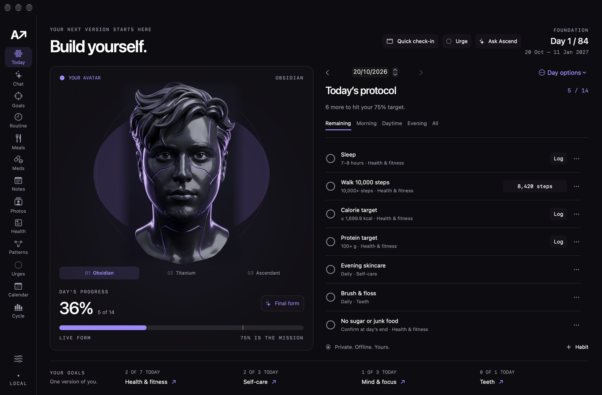
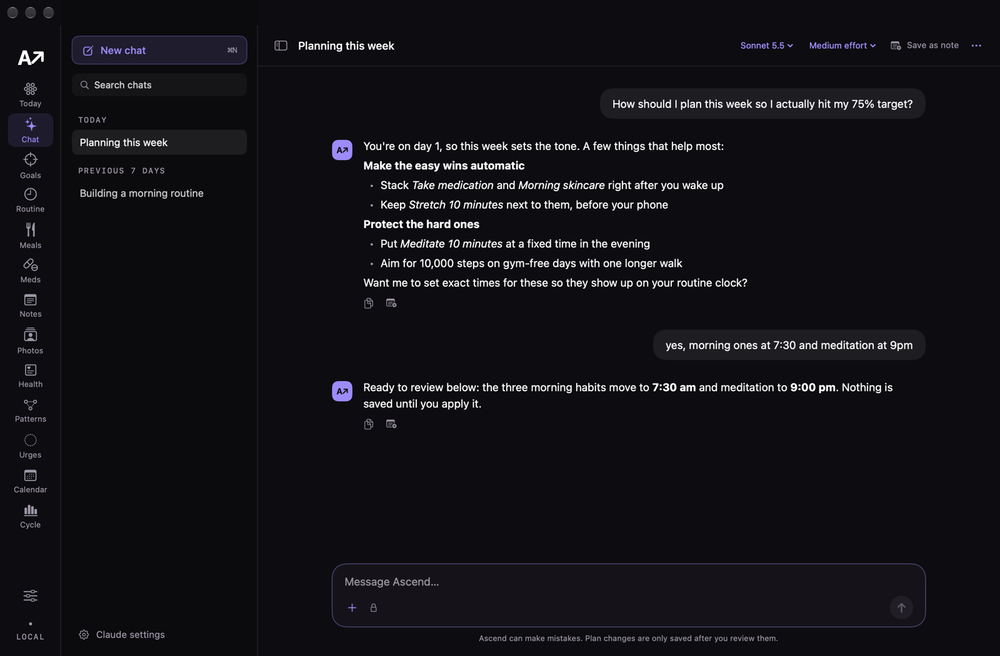
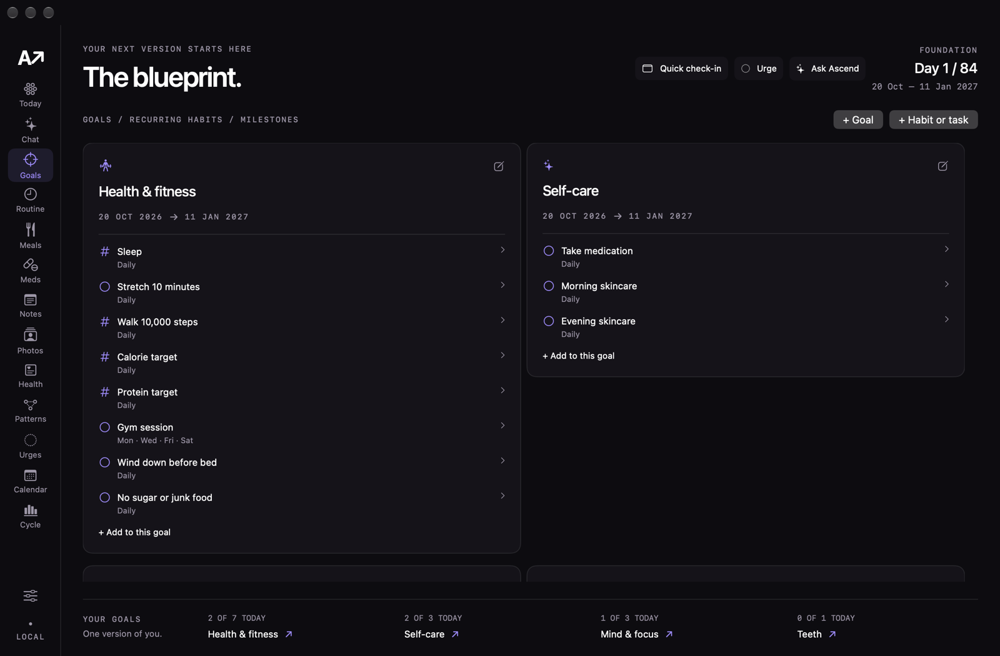
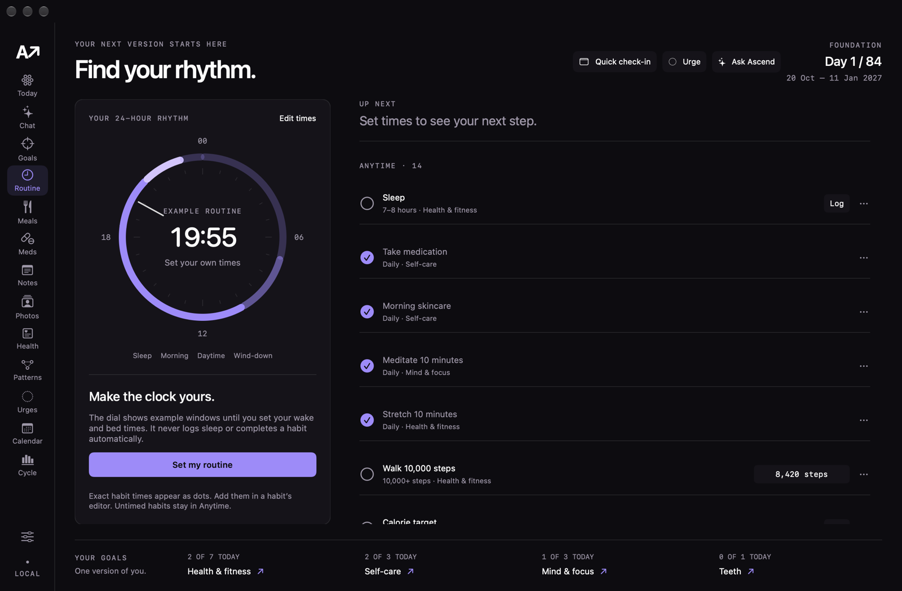

# Ascend

A private, local-first growth tracker for macOS, with an Android companion app.
Plan a 12-week cycle of goals and daily habits, check in from the Mac or your
phone, and let your watch, meal photos and medicine schedule fill in the numbers.
An avatar evolves (Obsidian → Titanium → Ascendant) as you earn the cycle.

- **Mac app** (SwiftUI): Today checklist, goals, routine clock, calendar, patterns,
  urges, meals, medicines, notes, progress photos, health charts and a menu bar panel.
- **Ask Ascend**: a full-screen chat that runs on your own [Claude Code](https://claude.com/claude-code)
  install. It talks through your plan and proposes edits you review before anything is saved.
- **Ascend Bridge** (Android): today's habits and avatar, meal and medicine photos,
  dose reminders and urge logging. It also brings Health Connect data (for example
  from a Mi Fitness watch) to the Mac over your Wi-Fi, end-to-end encrypted after a
  one-time 6-digit pairing.

Everything stays on your devices: no account, server, telemetry or cloud sync.
The only network calls are the phone-to-Mac link on your local network and the
Claude Code CLI when you use the AI features.

## Screenshots



| Ask Ascend chat | Goals |
|---|---|
|  |  |



Shown with the neutral starter plan and sample chats.

## Run

Requires macOS 14 or later and Apple Command Line Tools / Swift 6. The AI features
(chat, meal estimates, medicine sorting, note summaries) need Claude Code installed
and signed in; everything else works without it.

```sh
chmod +x scripts/build-app.sh
./scripts/build-app.sh
open build/Ascend.app
```

The app bundle is locally ad-hoc signed. No Apple account or server is needed.
For development, use `swift run --disable-sandbox Ascend`.

## Features

Full usage instructions: [User guide](docs/USER-GUIDE.md).

- Today: dated check-ins, numbers, morning/day/evening views and backfilling.
- Routine: a native 24-hour clock, configurable wake/bed/morning/wind-down windows,
  exact habit times and a next-event preview. Time changes preserve habit history.
- Patterns: daily sleep/caffeine/energy stories, optional mood/stress, manual sleep
  corrections, completed-log markers, local charts and evidence-gated comparisons.
  [Patterns guide](docs/PATTERNS.md).
- Urges: one-click timestamps for any urge, custom labels and optional intensity/trigger/outcome/notes,
  private history and delete/undo. Urges never change habit check-ins automatically.
  Choose Other to write a short custom trigger; local summaries use your wording.
- Health: optional Mi Fitness / Health Connect import from your Android phone over
  Wi-Fi, with heart-rate samples and eight other supported metrics. Ascend Bridge is
  paired once with a 6-digit code; it syncs the past 14 days when opened, or hourly
  in the background on Wi-Fi, encrypted, with no developer options. See [phone setup](docs/HEALTH-SYNC.md).
- Meals: photos from Ascend Bridge or dropped on the Mac get a Claude estimate of
  calories and macros; confirmed meals fill the Calorie and Protein target check-ins.
- Progress photos: dated hair, hairline, face and body photos by angle, before/after side by
  side or as a blended overlay, an optional Claude comparison you can save as a note, and
  album photos you can attach to Ask Ascend (which otherwise sees only their areas and dates).
  [User guide](docs/USER-GUIDE.md#progress-photos).
- Ask Ascend: a full-screen Claude chat (the Chat tab, Cmd-J) that runs on your own Claude Code account
  (`claude --personal`). Discuss goals and progress, or ask it to create/edit goals,
  habits, habit notes, cycle dates, routine windows and dated check-ins. Chats are saved
  with history, each with its own model (Opus, Sonnet, Haiku, Fable) and effort level
  (medium by default), and each one is a
  Claude Code session you can resume in Terminal. Up to four photos per message
  (picker, paste or drag-and-drop) are stored with the chat and Claude can see them. Every proposal is validated and
  reviewed before an atomic local save with backup/Undo. Requests are cancellable;
  stale, malformed or incomplete proposals cannot be applied.
- A neutral starter plan is preconfigured (edit or replace any of it), with zero fabricated check-ins.
- Calendar: monthly overview with past-date checkbox and numeric corrections, rest markers,
  Monday-first weeks and read-only future schedules. It respects the stored time zone.
- Day options: mark/resume rest days without losing values, or reset one date.
- Start fresh: start an 84/90-day cycle while retaining earlier records, or reset all
  check-in history while keeping the plan. Both create dated backups and offer Undo
  until the next edit or app quit. Restart moves all goal windows and active one-off due dates.
- Goals: editable start/end dates and recurring habits / one-off milestones.
- Gym defaults to Monday, Wednesday, Friday and Saturday; repeat days are editable.
- Cycle: 12 weeks (84 days) by default; Settings offers a 90-day preset or custom dates.
- Consistency: completed scheduled check-ins divided by scheduled check-ins.
  Rest days and milestones stay out of the denominator. Open today is excluded
  from closed-day review; unlogged past check-ins count as missed.
- Schedule, target and goal-window revisions apply from the edit date, preserving
  earlier scoring. Archived habits stay in past reviews.
- Avatar: Obsidian → Titanium → Ascendant, using the supplied personal renders.
  Follow progress reaches Titanium halfway to the cycle goal and Ascendant when
  the goal is earned. Stage buttons offer cosmetic previews without altering data.
  The portrait stays still under the pointer; stage crossfades respect Reduce Motion and there is no idle loop.
  Settings also offers a fixed appearance. Images are portraits, without mesh rotation.
- Menu bar: compact avatar and progress, Remaining/All tabs, scrollable tasks,
  quick completion/unchecking, numeric logging, a clock/avatar switch, urge logging,
  and History/Reminders/Assistant shortcuts.
  The same compact panel is available from Quick check-in or Cmd-Shift-K in the app.
- Optional local notifications: morning and evening times, optional sound, permission
  status, macOS settings link and a test button. Reminders skip rest/completed days,
  stay within the cycle and cover the next 30 days (up to 60 requests). Opening the
  app or changing data refreshes the queue. macOS Focus/settings can suppress banners.
  Defaults off; enabling requests system permission. Notification bodies use generic
  check-in messages, without habit titles.
- Export and restore JSON backups; archived habits can be restored as new entries.

## Local data and privacy

Data is saved atomically to:

```text
~/Library/Application Support/Ascend/tracker.json
```

The previous valid file is retained as `tracker.json.backup`. Invalid imports are
rejected. An unreadable main file is preserved rather than silently replaced;
the app recovers its backup when possible. Restoring creates a dated copy first.

The app uses the calendar time zone stored with your data (your Mac’s, on first launch).
The time zone is recorded in exported backups. There is no authentication,
telemetry or cloud sync. The avatar images ship in the app. Local tracking,
clocks, urge logs and notifications have no runtime network dependency. Optional
phone sync is an encrypted, paired connection on your local Wi-Fi (Ascend listens
while open and accepts only local-network addresses); it adds no cloud service.
Meal photos are stored in `~/Library/Application Support/Ascend/Meals/`; meal entries
live in tracker.json and its backups.

Ask Ascend runs the installed Claude Code CLI (`~/.local/bin/claude` by default) in print
mode with `CLAUDE_CONFIG_DIR=~/.claude-personal`, the same profile as `claude --personal`.
There is no API key in the app; `ANTHROPIC_*` variables are removed so usage stays on your
Claude login. Only messages you send go to Anthropic. Each one includes the current plan and,
unless turned off in Claude settings, progress, the last 14 days of check-ins and habit notes.
The Photos album is described by area, angle and date only; images go only when attached.
Urge records, health records and the wellbeing journal are never included.

Claude runs with no tools, no MCP servers and no user settings or hooks, and must answer with
a JSON schema (message + bounded actions). Ascend never executes model output; allowed
actions prepare an immutable preview that is checked again when applying.
Chats are stored in `~/Library/Application Support/Ascend/Claude/chats.json`, outside tracker
backups. Each chat ID is also the Claude Code session ID, so Claude Code keeps the transcript
under `~/.claude-personal/projects/` and the chat menu can copy a `claude --personal --resume`
command. Deleting a chat removes both. Sonnet 5.5 is the default model; Fable 5.1 may need
usage credits on your plan. Every request passes `--effort` (low to max; medium by default
for all models), set per chat or as the default for new chats in Claude settings.

Photos are re-encoded on attach (longest edge at most 1568 px; JPEG, or PNG when transparent),
which removes EXIF and location metadata. They are stored in `Claude/attachments/<chat id>/`
and sent as image blocks through `--input-format stream-json`, so Claude still has no file
access. Claude Code keeps them in the session, so later messages can refer back to them.
Deleting a chat deletes its photos.
Live watch streaming and body animation rigging are future work.

For isolated UI checks, launch the executable with a separate data folder:

```sh
ASCEND_DATA_DIR=/private/tmp/ascend-ui-test build/Ascend.app/Contents/MacOS/Ascend
```

## Development

```sh
CLANG_MODULE_CACHE_PATH=/private/tmp/ascend-module-cache swift run --disable-sandbox --cache-path /private/tmp/ascend-swift-cache AscendChecks
```

The portable Swift checks run with Command Line Tools, without XCTest or full Xcode.
They cover schedule/rest-day scoring, metric bounds, historical edits,
archiving, milestones, legacy backup defaults, rest/reset/restart behavior, leap days,
DST boundaries, reminder planning, routine geometry, urge validation, AI privacy,
atomic proposals, stale edits, HTTP failures, cancellation, pattern sample gates,
midnight caffeine windows, unknown/zero distinctions and avatar earning.
AI tests use a mocked launcher and fake CLI scripts. `ASCEND_LIVE_CLAUDE=1` adds a live
Haiku check through your personal profile; it removes its test session afterwards.
Health checks cover snapshot freshness, source/permission validation, corrections,
repeated imports, denied access, history retention, backup round trips and AI exclusion.
Link checks cover pairing confirm/decline, encrypted sync, replays, stale and forged
requests, local-only peers and the HTTP server on loopback; meal checks cover estimates,
validation and filling the Calorie/Protein check-ins. `scripts/check-phone-link.sh` also
runs the Android crypto and network code on the JDK against the real Mac server.
Release verification: [QA 0.5](docs/QA-0.5.md), [QA 0.4.1](docs/QA-0.4.1.md).

The current avatar originals and provenance are in `assets/avatar/abdul/` and
are bundled byte-for-byte under `Resources/Portraits`. Labels are cropped by the
view, preserving the supplied pixels. No image-generation or remote service is used.
The earlier Blender study, Three.js viewer and their build script remain in
`assets/avatar/`, `web/` and `scripts/bundle-avatar.mjs` as legacy source. They are
excluded from the app's runtime resources and are not needed to build the app.

This is a first local build, not a notarized distribution installer.

## Phone app (Ascend Bridge)

Ascend Bridge is plain Java against the Android SDK, with no Gradle, AndroidX or
third-party libraries. It needs Android 14 (API 34) or later and Health Connect.
`scripts/build-android-bridge.sh` expects two local toolchains under `build/tools/`:

- a JDK 21 at `build/tools/jdk-21.0.12.1+1/Contents/Home`
- an Android SDK at `build/tools/android-sdk`, with `platforms/android-36` and the
  build tools the script names (`d8`, `aapt2`, `zipalign`, `apksigner`)

The first build creates a local signing key in `build/android/` (never commit it).
`scripts/build-app.sh` bundles the APK into the Mac app; on the Mac, open
**Health → Install phone app** and scan the QR code to install it on the phone.

## Licence

MIT. See [LICENSE](LICENSE). The avatar portraits are the author's own likeness;
please replace them with your own images in forks or redistributions.
